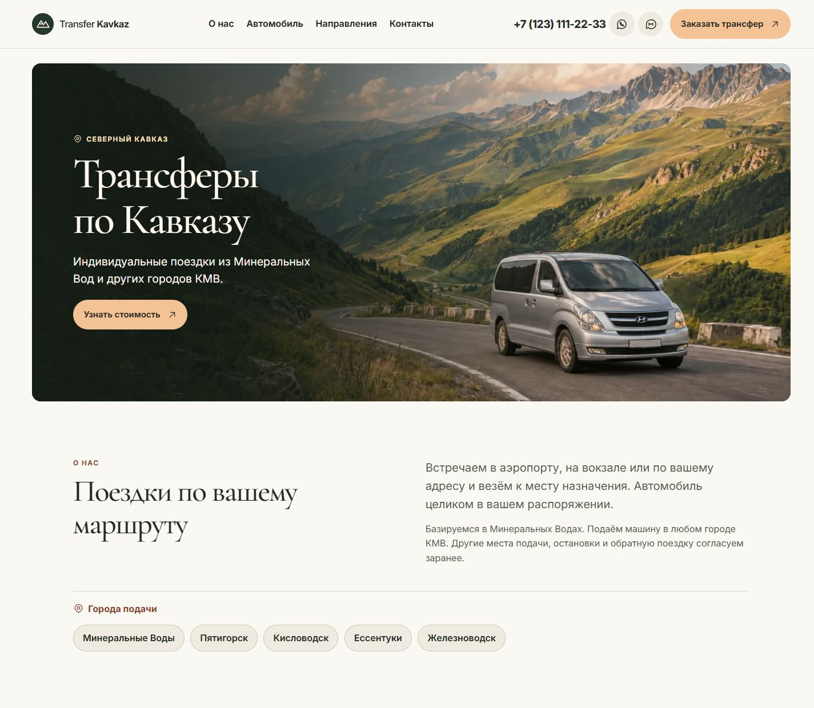
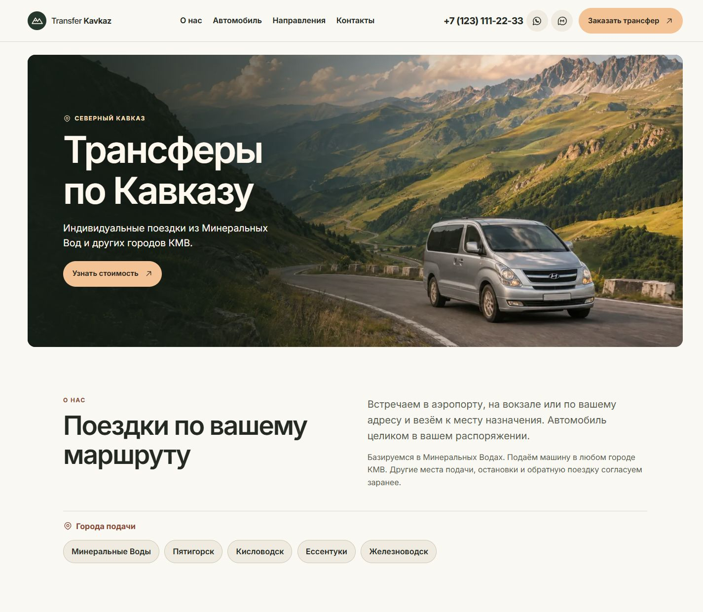
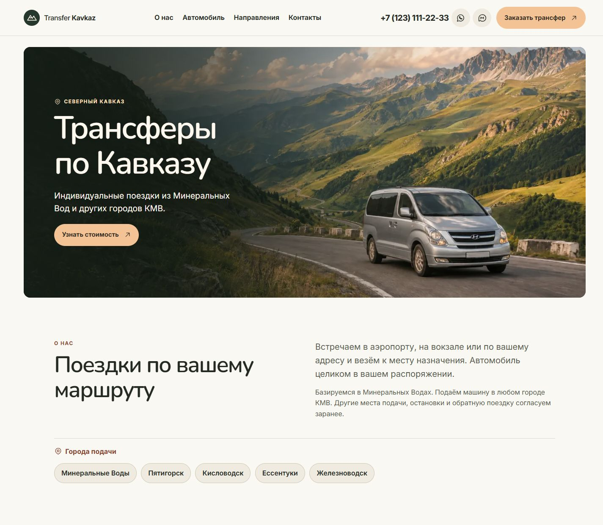

# Вторая итерация Transfer Kavkaz

## Текущая типографика

В заголовках используется Cormorant Garamond Medium. Его открытые формы, выразительные засечки и мягкий рисунок поддерживают атмосферу путешествия и сочетаются с горными фотографиями и тёплой палитрой.

Inter используется в основном тексте, навигации, телефоне и кнопках. Он хорошо читается в небольших размерах и помогает быстро находить действия. Оба семейства имеют кириллицу и загружаются из локальных WOFF2-файлов.

Во второй итерации уменьшен перепад размеров между текстовыми уровнями. При стандартном размере корневого шрифта главный заголовок меняется от 42 до 76 px, заголовки секций — от 34 до 54 px, карточек — от 25 до 31 px. Размеры задаются общими CSS-переменными.

## Альтернативы без засечек

В сравнениях изменены заголовки главной страницы. Основной текст и элементы управления используют Inter. Размеры, цвета, фотографии и композиция одинаковы. Шрифтовые варианты подготовлены как отдельные изображения.

### Inter SemiBold

Самый последовательный вариант для полностью единой типографики. Заголовки выглядят собранно и имеют более плотное начертание.

### Roboto Medium / SemiBold

Более компактный рисунок букв помогает длинным русским заголовкам занимать меньше места. В сравнении используется SemiBold.

### Nunito SemiBold

Округлые формы делают заголовки мягче. Этот вариант поддерживает дружелюбную туристическую атмосферу.

## Изображения автомобиля

Файлы находятся в `src/assets/images/`. Использован встроенный ImageGen.

- `hero-silver.webp` — прежняя композиция горной дороги с серебристым Grand Starex.
- `vehicle-silver.webp` — основной ракурс спереди.
- `vehicle-interior.webp` — пассажирский салон.
- `vehicle-rear.webp` — ракурс сзади.
- `vehicle-side.webp` — вид сбоку в горах.
- `chegem.webp` и `kislovodsk.webp` — изображения двух добавленных направлений.

Основное задание генерации для автомобиля — фотореалистичный серебристый Hyundai Grand Starex 2010 года с заводскими колёсами, исходной формой кузова и тонированными стёклами, в тёплом естественном освещении на фоне Кавказа. Для баннера и основного ракурса изменён цвет исходных изображений. Для дополнительных ракурсов серебристый автомобиль использован как референс. Салон показан как демонстрационная визуализация с обычной тканевой обивкой.

Задания для направлений — фотореалистичные виды Чегемских водопадов и Долины роз в Кисловодске, горизонтальная композиция 3:2, естественное освещение и природная палитра.
